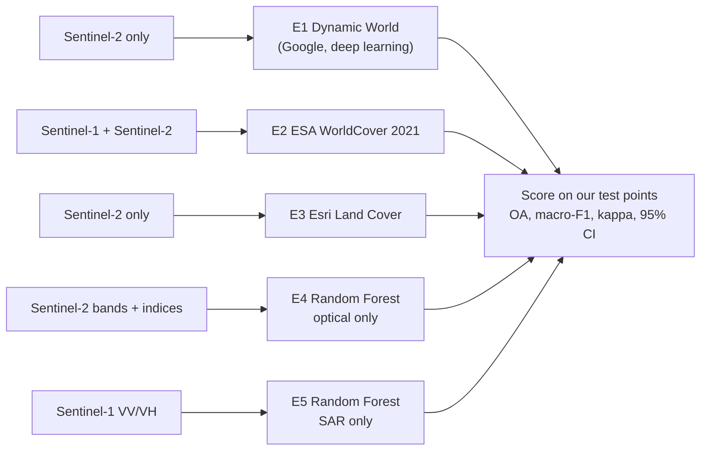
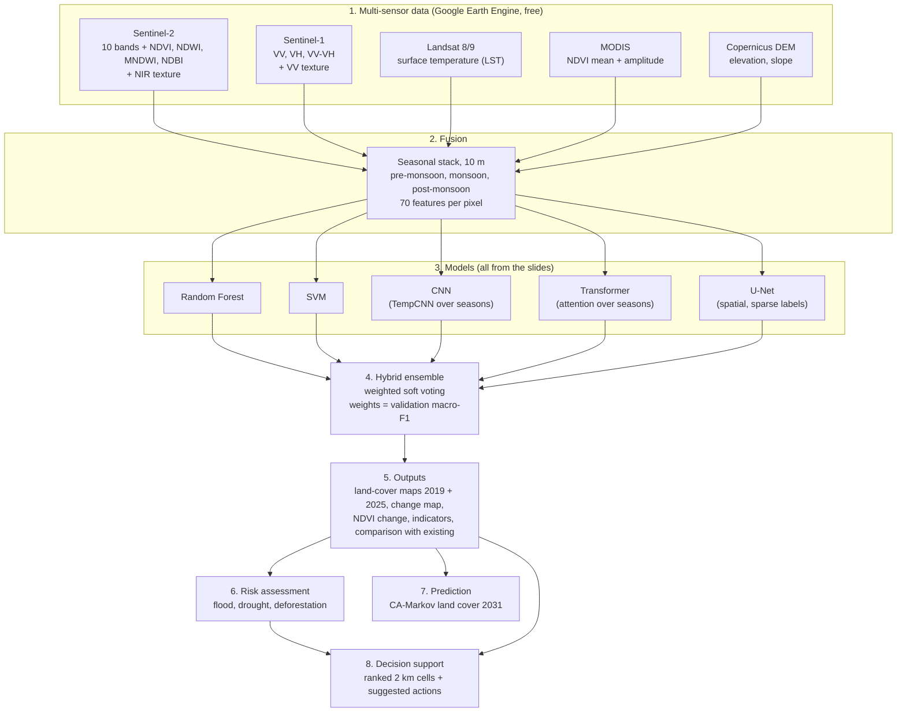

# Architecture

The project is built in two steps, both evaluated on the **same spatially held-out test points**
labelled by the team.

## Step 1 - Existing solutions (what we compare against)

Limits of the existing solutions:
* Global products are trained for the whole world, not tuned or checked for the Deccan landscape.
* E1, E3 and E4 use optical data only, so monsoon clouds hurt them.
* Each uses one model type.

## Step 2 - Hybrid architecture (our contribution)

"Hybrid" = **all sensors from the project slides x all models from the slides**, combined.

### Why each part is there
| Part | Reason |
|---|---|
| Sentinel-1 | Sees through monsoon cloud; separates water and buildings by surface roughness |
| Sentinel-2 | Main spectral information; vegetation, water and built-up indices |
| Landsat LST | Built-up areas and bare rock are hotter than vegetation and water |
| MODIS NDVI stats | Year-round vegetation rhythm (crops vs trees vs scrub) |
| DEM | Terrain context (hills, valleys, tank beds) |
| Three seasons | Crops, tanks and grass change through the year; forests and buildings do not |
| RF, SVM | Strong classical models on tabular features |
| CNN, Transformer | Learn the seasonal pattern of each pixel |
| U-Net | Uses the neighbourhood (shape, texture), not only the pixel |
| Weighted ensemble | Models make different mistakes; voting cancels some of them |
| GLCM texture | Separates rough surfaces (buildings, rocks) from smooth ones (water, fields) |
| Risk indices | Flood: monsoon-only radar water nearby + low, flat ground. Drought: 1 - Vegetation Health Index (dry-season NDVI and LST). Deforestation: remaining trees near recent tree loss or new buildings |
| CA-Markov | 2019-2025 transition rates, placed where the new class is already nearby, predicts 2031 |
| Decision support | 2 km cells ranked by a transparent priority score, each with its main issue and a suggested action |

## Validation (same for both steps)
* Hand-labelled points, never taken from any global product.
* 5 km spatial blocks; whole blocks go to train, validation or test, so nearby pixels can't leak.
* Ensemble weights come from validation blocks only; the test blocks are touched once, at the end.
* Report OA, precision, recall, macro-F1, mIoU, kappa, per-class precision/recall/F1/IoU, 95% bootstrap CI,
  and a paired CI for "hybrid minus best existing".
* Risk indices and the 2031 prediction are screening tools, not validated forecasts: with only two dates the
  prediction cannot be back-tested.
* A random point split is also run once, only to show how much it inflates accuracy.

## Free tools only
| Need | Tool | Cost |
|---|---|---|
| Satellite data + processing | Google Earth Engine (noncommercial) | Free |
| Coding + GPU | Google Colab or Kaggle | Free |
| Storage | Google Drive (15 GB) | Free |
| Code | GitHub | Free |
| Labelling | QGIS | Free |
| Demo | Streamlit (local, or Streamlit Community Cloud) | Free |
